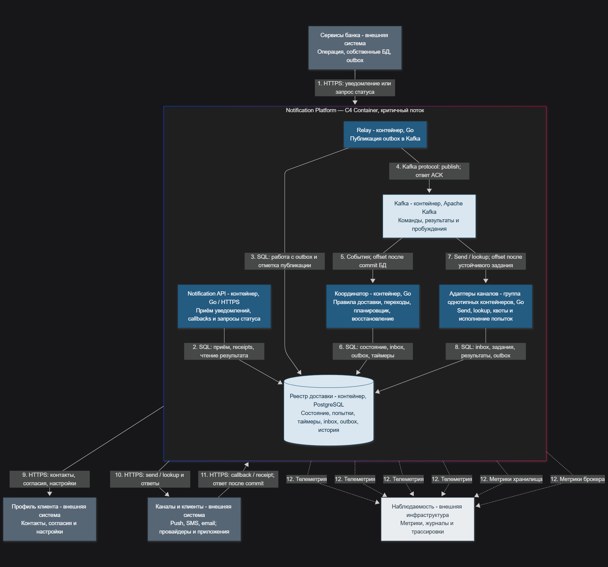
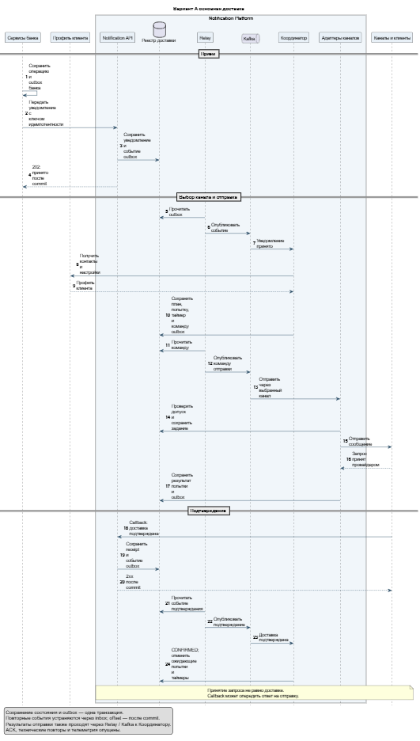
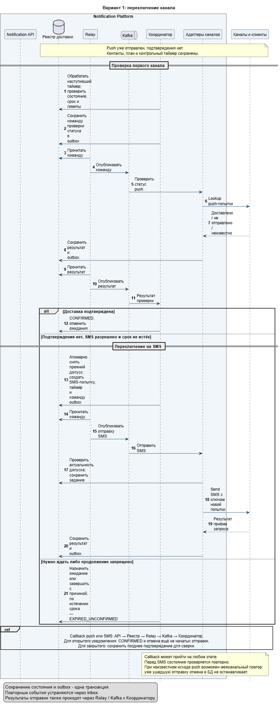
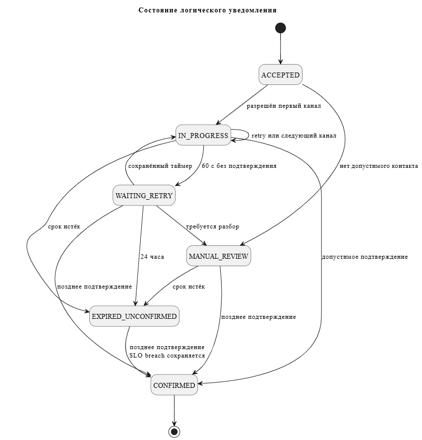
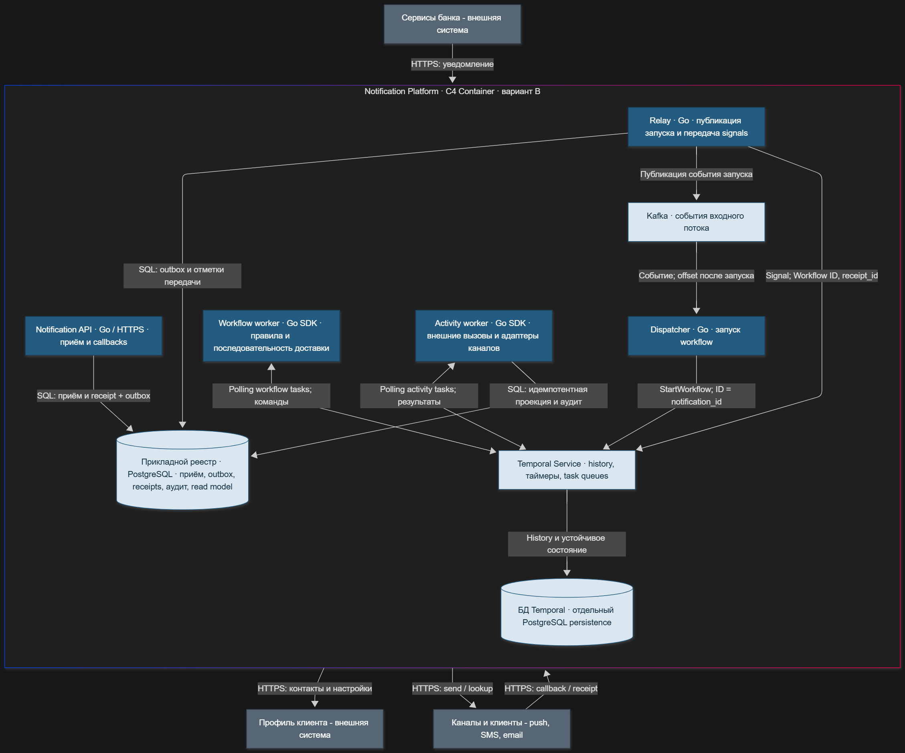
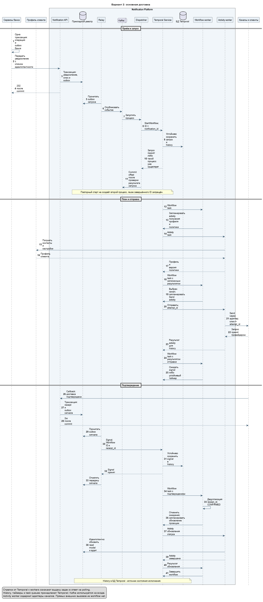
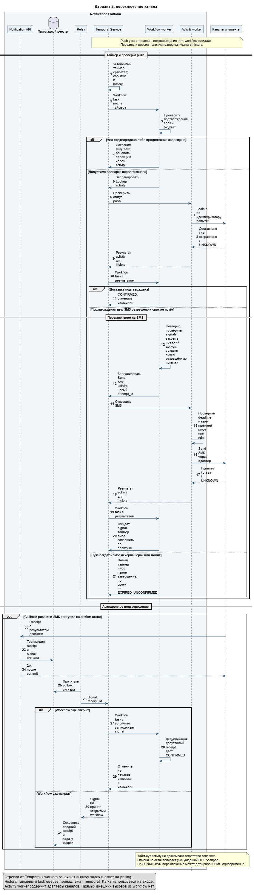

| Метаданные      | Значение                                                               |
|-----------------|------------------------------------------------------------------------|
| Статус          | DESIGN                                                                 |
| Автор(ы)        | Степанов Руслан Андреевич                                              |
| Ответственный   | Руководитель команды Notification Platform                             |
| Бизнес-заказчик | Владелец клиентских коммуникаций онлайн-банка                          |
| Ревьюеры        | Архитектуры, SRE, безопасность, мобильная команда, поддержка и финансы |
| Дата создания   | 2026-11-11                                                             |
| Дата обновления | 2026-11-11                                                             |

# Оглавление

1\. Контекст

2\. Продуктовый анализ

3\. Пользовательские сценарии

4\. Статистика

5\. Требования

6\. Варианты решения

7\. Сравнительный анализ

8\. Выводы

9\. Связанные задачи

10\. Приложения

# 

# Контекст

**Цель раздела:** Опсать проблему или возможность, которую решает данный RFC.

Разрозненные отправители уведомлений по-разному обрабатывают ошибки, не объединяют пользовательские настройки и не могут подтвердить доставку уведомлений. Повторы возникают как при повторной публикации события, так и при потере ответа провайдера. Перенос всех вызовов в один сервис без устойчивого состояния лишь централизует эту проблему.

Требуется обработать каждое критичное событие после проведения финансовой операции, сохранить её при отказах, выбрать подходящий канал, дождаться подтверждения и при необходимости переключиться между каналами. Подсистема не участвует в авторизации перевода, не заменяет одноразовые пароли и не определяет финансовый результат операции.

## Ключевые вопросы

\- **Какую проблему мы решаем?** Потерю контроля за критичным уведомлением при сбое и отсутствие согласованного межканального восстановления.

\- **Почему это важно?** Централизация при нагрузке до миллиона получателей кампании требует отделить критичные события от массовых отправок.

\- **Кто затронут этим изменением?** Клиенты, сервисы финансовых операций, организаторы кампаний, мобильная команда, поддержка, SRE и внешние провайдеры.

# Продуктовый анализ

<table>
<colgroup>
<col style="width: 18%" />
<col style="width: 40%" />
<col style="width: 40%" />
</colgroup>
<thead>
<tr class="header">
<th>Код</th>
<th>Цель</th>
<th>Как измерять</th>
</tr>
</thead>
<tbody>
<tr class="odd">
<td>B1</td>
<td>Рост удержания на 15% относительно исходного уровня</td>
<td>
D30 retention: доля клиентов, совершивших целевое действие на 30-й день. Например, 40% → 46%.

Эксперимент 8-12 недель, размер выборки рассчитывается по исходной конверсии.
</td>
</tr>
<tr class="even">
<td>B2</td>
<td>Снижение жалоб на 30%</td>
<td>Число подтверждённых жалоб на задержку, повторы и нежелательность на 100 тыс. уведомлений, сравнение 4 недель до и после, отдельно по типам.</td>
</tr>
<tr class="odd">
<td>B3</td>
<td>Надёжная доставка критичных уведомлений</td>
<td>Доля подтверждённых доставок до 60 секунд, число неподтверждённых и потерянных обязательств.</td>
</tr>
</tbody>
</table>

Продуктовый охват: обязательные критичные события, отключаемые сервисные и маркетинговые сообщения, предпочтения каналов, история.

RFC детализирует механизм доставки критичных оповещений.

# Пользовательские сценарии

**Цель раздела:** Описать как пользователи будут взаимодействовать с системой.

| Приоритет   | Тип сценария            | Действующее лицо     | Сценарий                                                                                                                                        |
|-------------|-------------------------|----------------------|-------------------------------------------------------------------------------------------------------------------------------------------------|
| MUST HAVE   | Транзакционный          | Клиент банка         | Получает подтверждение перевода по выбранному доступному каналу. При отсутствии подтверждения система переключается на резервный канал. F2, F3. |
| MUST HAVE   | Повтор запроса          | Сервис банка         | После потери ответа повторяет событие с прежним ключом и получает тот же ID. F1, F4.                                                            |
| MUST HAVE   | Настройки               | Клиент банка         | Отключает маркетинг и обычные сервисные сообщения. Обязательные события остаются включёнными. F3, F7.                                           |
| MUST HAVE   | Кампания                | Маркетолог           | Запускает, приостанавливает или отменяет кампанию до 1 млн получателей. Отписавшиеся исключаются. F6.                                           |
| MUST HAVE   | Неопределённая доставка | Поддержка            | Видит попытки, UNKNOWN и нарушение срока достаки, получает задачу разбора без ложного статуса успеха. F8, F10.                                  |
| MUST HAVE   | Безопасность            | Клиент банка         | Получает безопасный краткий текст. Детали доступны после входа в приложение. F9.                                                                |
| SHOULD HAVE | Оптимизация затрат      | Владелец платформы   | При равной пригодности каналов использует менее дорогой и контролирует аварийный бюджет. F11, F12.                                              |
| COULD HAVE  | Аналитика               | Продуктовый аналитик | Получает интерактивный разрез задержек и стоимости по сегментам. Базовая отчётность F12 обязательна, дополнительный интерфейс опционален.       |

### Приоритеты:

\- **MUST HAVE** - обязатльно к реализации.

\- **SHOULD HAVE** - желательно реализовать.

\- **COULD HAVE** - опционально, при наличии ресурсов.

# Статистика

Исходные данные:

- **MAU** (Monthly Active Users / число уникальных активных пользователей за месяц): **10 млн.**

- **DAU** (Daily Active Users / число уникальных активных пользователей за день): **3 млн.**

- **Оновременно** до **300 тыс**. пользователей.

- **10 уведомлений** на пользователя в день: по **2 транзакционных**, **3 сервисных** и **5 маркетинговых**.

Проведенные расчеты приложены к этому документу:

- Проведение расчета: supplementary/platform_validation/capacity_planning.py;

- Результат расчета: supplementary/platform_validation/capacity_planning_output.py.

| Класс                              | Уведомлений в день при 3 млн DAU | Средняя скорость в секунду | Принятый пик |
|------------------------------------|----------------------------------|----------------------------|--------------|
| Транзакционные                     | 6,000,000                        | 69.44                      | 5,000/с      |
| Сервисные                          | 9,000,000                        | 104.17                     | 2,500/с      |
| Маркетинговые входящие предложения | 15,000,000                       | 173.61                     | 1,000/с      |
| Всего                              | 30,000,000                       | 347.22                     | 8,500/с      |

Пик задан как отдельное проектное допущение, а не выведен из среднего. В его обосновании: синхронный всплеск 300 тыс. клиентов по одному критичному событию за 60 секунд даёт 5,000/с. Уведомления маркетинговых кампаний дополнительно ограничиваются. Это не означает, что все одновременные пользователи всегда создают такой поток.

Одна маркетинговая кампания 1 млн / 1,200 с = 833.33 получателя/с:

- при квоте 1,000/с её передача укладываются примерно в 20 минут с небольшим запасом;

- целевое окно 60 минут оставляет запас на проверки и разрешённые задержки.

- кампания - подмножество маркетингового потока, не дополнительный миллион поверх него. «Тихие часы», отписки и квоты учитываются. Нельзя обещать 60 минут от момента создания кампании ночью.

## Попытки и записи

***Среднее число канальных попыток***

Примем за основу проектное предположение:

- каждое критичное уведомление сначала отправляется как push

- для 10% уведомлений дополнительно требуется SMS

- а для 2% от общего числа уведомлений - ещё и email.

Итого получается 112 попыток на 100 уведомлений:

(100+10+2)/100 = 1 +0.10 + 0.02 = **1.12**.

Здесь 2% - часть исходных уведомлений, дошедшая до email, а не 2% от SMS-попыток.

***Количество попыток за сутки***

При 3 млн. активных пользователей в день и двух транзакционных уведомлениях на пользователя: 3,000,000 x 2 = 6,000,000 критичных уведомлений/сутки.

Следовательно: 6,000,000 x 1,12 = **6,720,000 попыток/сутки**.

Это 6 млн push + 600 тыс. SMS + 120 тыс. email.

***Средняя интенсивность***

В сутках 24 x 60 x 60 = 86,400 секунд.

6,720,000 / 86,400 = **77,78 попытки/с**.

***Пиковая интенсивность***

При принятом значении пика в **5,000 критичных уведомлений/с** и предположении о сохранении тех же долей каналов:

5,000 x 1,12 = 5,600 попыток/с на пике.

Это оценка нагрузки при базовом распределении каналов, **не максимальная аварийная нагрузка**. Повторные запросы, резервный SMS-провайдер и массовый отказ push могут увеличить число попыток.

***Аварийная нагрузка на внешние каналы***

В пределах быстрого окна доставки - первых 60 секунд - на одно критичное уведомление предусматривается до 5 отправляющих запросов: два push-вызова, по одному запросу к двум SMS-провайдерам и один email. Повтор push допускается только при достоверном непринятии первого запроса. При входящем пике 5 000 уведомлений/с это соответствует 25 000 отправляющих запросов/с; при удвоенной нагрузке квалификационного испытания - 50 000/с.

Дополнительно резервируется до двух запросов проверки статуса (*lookup*) на каждую попытку. Вместе с отправками получается до 5 x (1 + 2) = 15 исходящих HTTP-запросов на уведомление: 75 000 запросов/с при обычном пике и 150 000/с при удвоенном.

Это консервативная расчётная нагрузка для выбора квот и числа соединений при контролируемом распределении запросов во времени. Кратковременные всплески необходимо ограничивать отдельно.

Обратные уведомления провайдеров (*callbacks*) создают дополнительную входящую нагрузку. Для отложенных попыток выделяется отдельная ограниченная квота. Повторами должен управлять согласованный механизм: независимые повторы в клиенте, адаптере и оркестраторе могут многократно увеличить число запросов.

***Нагрузка на хранилище состояния***

Для оценки принимаются два устойчивых изменения на уведомление и четыре - на каждую попытку доставки. При 6 млн. критичных уведомлений в сутки и среднем числе попыток 1,12 получаем:

6,000,000 x (2 + 4 x 1,12) = 38,880,000

логических операций записи в сутки, то есть 450/с в среднем.

При пике 5,000 уведомлений/с нагрузка составляет

(5,000 x 6,48 = 32,400 записей/с.

В аварийном сценарии с пятью попытками на уведомление она возрастает до

5,000 x (2 + 4 x 5) = 110,000 записей/с, а при удвоенном пике - до 220 000/с.

Эти числа оценивают логические изменения состояния, а не физические операции ввода-вывода. Запись журнала, обновление индексов, репликация создают дополнительную нагрузку на базы данных. Поэтому достаточность конфигурации базы данных необходимо подтвердить испытаниями.

***Начальная конфигурация хранения***

Испытания предлагается начать с восьми шардов критичного состояния, распределяя уведомления по хешу notification_id. Каждый шард включает основной узел (*primary*) и две реплики, размещённые в трёх разных зонах.

При равномерном распределении обычный пик составляет 32,400 / 8 = 4,050 логических записей/с на шард, а аварийный сценарий при удвоенном пике - 220,000 / 8 = 27,500 записей/с.

Восемь шардов - исходная конфигурация испытаний, а не доказанная достаточная мощность. Маркетинговые записи и аналитика размещаются отдельно.

## Хранение и сеть

***Хранение входящих событий в Kafka***

При размере одного сообщения с метаданными 1 КБ поток из 30 млн уведомлений составляет 30 ГБ в сутки. Хранение за семь суток (*retention*) требует 30 x 7 = 210 ГБ без репликации.

При трёх копиях данных и запасе ёмкости 50% получаем:

210 x 3 x 1,5 = 945 ГБ

При пике 8,500 уведомлений/с входящий трафик составляет около 8,5 МБ/с без репликации и протокольных расходов.

***Хранение истории критичных уведомлений***

При размере записи уведомления 1 КБ, записи попытки 0,5 КБ и среднем числе попыток 1,12 на одно уведомление требуется:

1 + 1,12 x 0,5 = 1,56 КБ.

Для 6 млн. критичных уведомлений в сутки за 30 дней это составляет 280.8 ГБ исходных данных. Если удвоить объём для учёта индексов и служебных данных, а затем предусмотреть три копии, потребуется:

280.8 x 2 x 3 = 1,684.8 ГБ =1.685 ТБ.

Журнал, резервные копии и годовой аудит в эту оценку не входят. При суммарном объёме минимального аудита 0,3 КБ на критичное уведомление годовое хранение потребует 6,000,000 x 365 x 0,3 КБ = 657 ГБ без репликации.

***Число незавершённых процессов и накопление очереди***

По закону Литтла среднее число процессов в системе равно интенсивности поступления, умноженной на среднее время нахождения:

$$L = \lambda W$$

При устойчивом потоке 5,000 уведомлений/с и среднем пребывании в быстром окне 60 секунд получаем 300 тыс. одновременно незавершённых процессов. Это оценка для указанного режима, а не универсальный предел: при меньшем времени завершения процессов будет меньше, при длительном ожидании - больше.

Если весь базовый суточный поток критичных уведомлений остаётся неподтверждённым в течение 24 часов, накапливается до 6 млн таких процессов. Их таймеры сохраняются в устойчивом хранилище.

При полной остановке обработки на час и непрерывном поступлении 5,000 событий/с очередь вырастет до:

5,000 x 3,600 = 18,000,000 событий.

Чтобы разобрать её за следующий час и одновременно обслуживать новые 5,000 событий/с, потребуется суммарная скорость обработки 10,000 событий/с.

Такой продолжительный пик превышает базовый суточный объём критичного потока и рассматривается отдельно как стресс-сценарий.

# Требования

## Функциональные требования

**Определение:** Функциональные требования определяют, каким должно быть поведение продукта в тех или иных условиях.

| №   | Приоритет   | Обозначение | Требование                                                                                                                                                                 |
|-----|-------------|-------------|----------------------------------------------------------------------------------------------------------------------------------------------------------------------------|
| 1   | MUST HAVE   | F1          | Любая команда банка может передать уведомление с получателем, типом, контекстом и сроком актуальности и получить устойчивый идентификатор для отслеживания.                |
| 2   | MUST HAVE   | F2          | Критичное уведомление должно быть доставлено хотя бы по одному доступному каналу, при неподтверждённой доставке система автоматически пробует разрешённый резервный канал. |
| 3   | MUST HAVE   | F3          | Клиент выбирает предпочтительный канал и отдельно отключает необязательные типы и каналы, критичные уведомления сохраняются включёнными.                                   |
| 4   | MUST HAVE   | F4          | Повторное обращение по одному событию не создаёт новое логическое уведомление, подтверждённая доставка останавливает ещё не начавшиеся резервные отправки.                 |
| 5   | MUST HAVE   | F5          | Критичные уведомления обслуживаются раньше необязательных, массовая кампания не должна задерживать сообщения о финансовых операциях.                                       |
| 6   | MUST HAVE   | F6          | Уполномоченный сотрудник запускает, приостанавливает и отменяет кампанию до 1 млн получателей, исключаются отписавшиеся клиенты.                                           |
| 7   | MUST HAVE   | F7          | Для необязательных уведомлений соблюдаются “тихие часы” 21:00–09:00 по часовому поясу клиента и общий предел 2 маркетинговых сообщений в день.                             |
| 8   | MUST HAVE   | F8          | Сотрудник поддержки видит историю попыток, итог и причину отсутствия подтверждения, клиент видит одну запись критичного уведомления в истории банка.                       |
| 9   | MUST HAVE   | F9          | Владелец продукта выбирает утверждённый шаблон и язык.                                                                                                                     |
| 10  | MUST HAVE   | F10         | Если обычная доставка исчерпана, ответственный сотрудник получает задачу на разбор, уведомление не объявляется доставленным без доказательства.                            |
| 11  | SHOULD HAVE | F11         | При равной пригодности каналов выбирается менее дорогой, учитываются предпочтение клиента, срок доставки и резервирование платного канала.                                 |
| 12  | MUST HAVE   | F12         | Отправитель может получить текущий статус и итог доставки, а оператор - отчёт по задержкам, ошибкам, повторам и стоимости.                                                 |

## Нефункциональные требования

Введем следующие определения:

***Нефункциональные требования***

Нефункциональные требования определяют не что система делает, а как хорошо она это делает.

***Временные отметки и измерение задержек***

Для каждого уведомления фиксируются четыре момента:

| Обозначение | Значение                                                                                  |
|-------------|-------------------------------------------------------------------------------------------|
| t_event     | Исходная операция, например перевод, зафиксирована в системе банка                        |
| t_accept    | Платформа сохранила уведомление и приняла его на обработку                                |
| t_submit    | Внешний провайдер принял запрос на отправку, это ещё не подтверждение доставки            |
| t_confirm   | Платформа получила достоверное подтверждение доставки по правилам соответствующего канала |

Интервал (t_confirm - t_accept) включает обработку, ожидание, отправку и задержку поступления подтверждения, в том числе обратного вызова провайдера - callback. Поэтому он может превышать фактическое время доставки клиенту.

Процентили задержек рассчитываются отдельно по классам уведомлений и каналам за последние 30 дней - это скользящее окно, обновляемое со временем.

Дополнительно анализируются пятиминутные интервалы, чтобы длительная статистика не скрывала кратковременные ухудшения.

Временные отметки формируются по синхронизированным серверным часам. Погрешность синхронизации учитывается при измерениях между системами.

Под **p99** понимается 99-й процентиль времени выполнения операции: значение, в которое укладываются 99% измеренных операций.

На оснве введенных определений опишем нефункциональные требования:

<table>
<colgroup>
<col style="width: 4%" />
<col style="width: 14%" />
<col style="width: 16%" />
<col style="width: 64%" />
</colgroup>
<thead>
<tr class="header">
<th>№</th>
<th>Приоритет</th>
<th>Обозначение</th>
<th>Требование</th>
</tr>
</thead>
<tbody>
<tr class="odd">
<td>1</td>
<td>MUST HAVE</td>
<td>N1</td>
<td>
* Приём критичного сообщения: p99 ≤ 150 мс.

* t_submit - t_accept: p99 ≤ 2 с при исправном основном провайдере и нормативной нагрузке.

* t_accept - t_event: p99 ≤ 1 с для подключённых отправителей.
</td>
</tr>
<tr class="even">
<td>2</td>
<td>MUST HAVE</td>
<td>N2</td>
<td>
* Приём 8500 логических сообщений в сек. непрерывно 30 минут.

* Квалификационный нагрузочный тест: 17 000 в сек. в течение 15 минут.

* 5000 критичных сообщений в сек.

* Кампания 1 млн допустимых получателей передаётся провайдерам за ≤ 60 минут вне «тихих часов».
</td>
</tr>
<tr class="odd">
<td>3</td>
<td>MUST HAVE</td>
<td>N3</td>
<td>
≥ 99,95% допустимых критичных уведомлений получают подтверждение хотя бы одного канала за 60 сек.

≥ 99,99% - за 24 ч.

Неподтверждённый остаток учитывается и эскалируется.
</td>
</tr>
<tr class="even">
<td>4</td>
<td>MUST HAVE</td>
<td>N4</td>
<td>
* Доступность <em>приёма критичного потока</em> ≥ 99,95% за 30 дней.

* Потеря одной <em>зоны</em> сервиса не теряет уже принятые обязательства:

RPO (Recovery Point Objective) = 0 (все подтверждённые до аварии записи должны сохраниться; ни одно уведомление, приём которого платформа уже подтвердила, не должно исчезнуть из-за потери зоны),

RTO (Recovery Time Objective) ≤ 60 с. (обработка должна восстановиться в оставшихся зонах максимум за 60 с.; эти 60 с. - это срок восстановления работы, а не срок доставки всех накопившихся уведомлений; обработка очереди после восстановления может занять дополнительное время),

* Для полной потери <em>региона</em>:

RPO (Recovery Point Objective) ≤ 5 мин (изменения за не более, чем 5 поледних минут до аварии, могут отсутствовать),

RTO (Recovery Time Objective) ≤ 60 мин, с последующей сверкой отправителей.
</td>
</tr>
<tr class="odd">
<td>5</td>
<td>MUST HAVE</td>
<td>N5</td>
<td>
Ограничить дублирование уведомлений внутри платформы и повторное получение одного сообщения клиентом через разные каналы:

* В течение 30 дней повтор одного ключа не создаёт второй логический объект:

каждое уведомление идентифицируется своим ключом; если сервис повторит запрос, не получив ответ платформы, то платформа должна найти ранее принятое уведомление, вернуть его прежний идентификатор, не создавать новое уведомление для того же события и назначения -&gt; это свойство называется <strong>идемпотентностью приёма.</strong>

* Тесты гонок не допускают две одновременно активные разрешённые попытки:

когда несколько обработчиков одновременно пытаются изменить состояние одного уведомления, тоо для одного уведомления разрешается не более одной активной попытки в своём состоянии. Конкурирующие обработчики не должны создать две независимые отправки одного следующего шага.

* Доля обнаруженных межканальных повторов ≤ 0,1% критичного потока за 30 дней:

при мжканальный повторе одно логическое уведомление доставлено клиенту через несколько каналов, например одновременно в push и SMS из-за позднего подтверждения push; цель – минимизировать повторы, например, при 1 000 000 критичных уведомлений за 30 дней целевой предел - не более 1 000 уведомлений с обнаруженным межканальным повтором.
</td>
</tr>
<tr class="even">
<td>6</td>
<td>MUST HAVE</td>
<td>N6</td>
<td>Кампания не увеличивает p99 отправки критичного сообщения выше 2 с. При перегрузке сначала ограничивается маркетинг, критичные ресурсы резервируются.</td>
</tr>
<tr class="odd">
<td>7</td>
<td>MUST HAVE</td>
<td>N7</td>
<td>
* Все соединения защищены TLS.

* Все операции операторов авторизуются и аудируются.

* В логах и трассировках отсутствуют тексты и открытые контакты.

* Нулевые утечки тестовых маркеров персональных данных в автоматической проверке.
</td>
</tr>
<tr class="even">
<td>8</td>
<td>MUST HAVE</td>
<td>N8</td>
<td>
* 100% изменений статуса критичных сообщений имеют notification_id, attempt_id, причину и время.

* Серьёзный сбой выявляется ≤ 60 сек.
</td>
</tr>
<tr class="odd">
<td>9</td>
<td>MUST HAVE</td>
<td>N9</td>
<td>
* Изменение согласия клиента на получение уведомлений применяется к новым необязательным отправкам за ≤ 5 с.

* При недоступном достоверном состоянии согласия новые необязательные отправки блокируются.
</td>
</tr>
<tr class="even">
<td>10</td>
<td>MUST HAVE</td>
<td>N10</td>
<td>
* Операционная история критичных сообщений хранится 30 дней.

* Удаление истёкших рабочих данных ≤ 24 ч.

* Восстановление проверяется ежеквартально.
</td>
</tr>
<tr class="odd">
<td>11</td>
<td>SHOULD HAVE</td>
<td>N11</td>
<td>
* В стандартном режиме для контроля бюджета доля SMS-попыток ≤ 15% критичных уведомлений, расходы контролируются ежедневно.

* При аварии ограничение стоимости не блокирует обязательный failover. Идет отправка SMS уведомлений за пределами бюджета для того, чтобы сохранить работоспособность системы.
</td>
</tr>
</tbody>
</table>

.

**Расчёт нагрузки**

Базовый сценарий предполагает 3 млн. активных пользователей в день и по 2 транзакционных, 3 сервисных и 5 маркетинговых событий на пользователя:

| Показатель                                               | Расчёт и результат                                          |
|----------------------------------------------------------|-------------------------------------------------------------|
| Входящий поток за сутки                                  | 3 000 000 × (2 + 3 + 5) = 30 000 000 уведомлений            |
| Средняя интенсивность                                    | 30 000 000 / 86 400 ≈ 347,22 уведомления/с                  |
| Проектный пик                                            | 5 000 + 2 500 + 1 000 = 8 500 уведомлений/с по трём классам |
| Нагрузка квалификационного испытания                     | 8 500 × 2 = 17 000 уведомлений/с                            |
| Разворачивание кампании на 1 млн получателей за 20 минут | 1 000 000 / 1 200 ≈ 833,33 получателя/с                     |
| Базовое число критичных попыток доставки                 | 6 000 000 × (1 + 0,10 + 0,02) = 6 720 000 попыток/сутки     |

Пиковая нагрузка задаётся отдельным проектным предположением, а не выводится из среднего. В расчёте попыток каждому критичному уведомлению соответствует push, для 10% дополнительно требуется SMS, для 2% от общего числа - email.

Полные допущения, оценки хранения и аварийной нагрузки приведены в разделе «Статистика».

**Цели и границы RFC**

Документ описывает механизм выполнения F1-F5 и F8-F12 с учётом N1-N11 и архитектурно значимых требований A1-A6. За его пределами остаются алгоритм персонализации маркетинга, интерфейс редактора шаблонов, конкретные договоры с провайдерами, юридическая квалификация сообщений и полная промышленная реализация платформы.

**Гарантия сохранения ответственности**

После t_accept обязательство по обработке уведомления устойчиво хранится до подтверждённой доставки либо явного завершения с зафиксированной причиной и задачей разбора. Повторная обработка событий очереди допускается, но благодаря дедупликации не создаёт новое логическое уведомление в пределах установленного срока хранения ключей. При отказе одной зоны уже принятое состояние сохраняется согласно принятой модели отказоустойчивости.

**Условия доставки и срок попыток**

Автоматическая доставка возможна, если существует проверенный доступный канал с достоверным подтверждением, контакты остаются действительными, а инфраструктура и провайдеры восстанавливаются до окончания срока актуальности. При этих условиях платформа выполняет предусмотренные попытки до подтверждения, исчерпания их лимита или истечения срока.

Для рассматриваемых подтверждений финансовых операций срок автоматической доставки составляет 24 часа. Если подтверждение не получено, уведомление переходит в EXPIRED_UNCONFIRMED - «срок истёк, доставка не подтверждена», а не в состояние успеха. Оператор сверяет результат и при необходимости создаёт новое связанное уведомление с актуальным содержимым.

**Ограничения гарантии**

Если все каналы недоступны, контакты недействительны или устройство недоступно дольше срока доставки, гарантировать получение сообщения за установленное время нельзя.

Также невозможно одновременно гарантировать быстрое переключение на резервный канал и полное отсутствие межканальных повторов при потерянном подтверждении: первая отправка могла уже состояться. В такой ситуации отдаётся приоритет своевременному оповещению, сохраняя и учитывая остаточный риск повторного сообщения.

### Что считается подтверждением

| Канал | Допустимое доказательство для t_confirm                                                                          | Что не является доказательством                     |
|-------|------------------------------------------------------------------------------------------------------------------|-----------------------------------------------------|
| Push  | Аутентифицированный ACK приложения о получении конкретного notification_id. ACK связан с получателем и попыткой. | HTTP 200 от APNs - это только принятие провайдером. |
| SMS   | Проверенный финальный delivered DLR от контрактного провайдера с известной семантикой подтверждения доставки.    | queued, accepted, sent без DLR.                     |
| Email | Проверенное событие доставки на сервер адресата, если оно доступно в контракте.                                  | Приём запроса email-провайдером.                    |

Ни одно из этих доказательств не означает, что человек прочитал сообщение. Для email доказательство слабее, чем получение приложением: возможны фильтрация и папка спама.

Метрики хранят evidence_type. Каналы показываются отдельно. Если бизнес требует именно получения устройством, email исключается из каналов N3 и остаётся дополнительной попыткой. Отличие приёма и доставки подтверждается документацией каналов.

# Варианты решения

Банковский сервис сохраняет финансовую операцию и запись о необходимости отправить уведомление в таблице **outbox** одной локальной транзакцией. Операция не может быть зафиксирована без соответствующего задания на уведомление. Фоновый процесс **relay** передаёт это задание платформе и повторяет отправку с тем же ключом идемпотентности, пока платформа не подтвердит устойчивое принятие. Согласованность между банковским сервисом и платформой обеспечивается повторной передачей и устранением дубликатов.

**Notification API** проверяет полномочия отправителя, тип уведомления и допустимость шаблона, затем одной транзакцией создаёт уведомление и запись в собственном **outbox** для дальнейшей обработки. Ответ **202 Accepted** возвращается только после успешного сохранения транзакции: уведомление принято, но ещё не доставлено. Если хранилище недоступно, API возвращает **503 Service Unavailable**, а задание остаётся в **outbox** отправителя. Если ответ потерян и результат приёма неизвестен, отправитель повторяет запрос с тем же ключом и платформа возвращает результат для уже созданного уведомления, не создавая второе.

Критичные, сервисные и маркетинговые уведомления обрабатываются в раздельных потоках.

Ниже рассматриваются варианты реализации критичной подсистемы. Правила доставки, история и контракты каналов в обоих вариантах одинаковы. В варианте 2 Kafka остается и также используется для приёма и передачи массовых событий, а выполнение процессов доставки и устойчивое хранение таймеров передаются Temporal.

## Вариант 1: Kafka и автомат состояний в PostgreSQL

**Подход варианта 1:** PostgreSQL хранит состояние процессов доставки и расписание действий, а Kafka передаёт события и команды, запускающие обработку.

**Архитектура**

C4 Container диаграмма и таблица, приведенные ниже, отражают из каких элементов (сервисов и хранилищ) состоит система и кто с кем взаимодействует.

| Элемент                                | За что отвечает                                                                                                                                                                          |
|----------------------------------------|------------------------------------------------------------------------------------------------------------------------------------------------------------------------------------------|
| Сервисы банка - внешняя система        | Фиксируют финансовую операцию и задание на уведомление. Их собственные БД, outbox и relay находятся внутри этой внешней системы.                                                         |
| Notification API                       | Принимает уведомления, обратные сообщения каналов (callbacks) и запросы банка о текущем статусе. Проверяет полномочия и данные.                                                          |
| Реестр доставки - PostgreSQL           | Хранит состояние уведомлений, попытки отправки, таймеры, inbox, outbox, историю и задачи разбора.                                                                                        |
| Relay                                  | Забирает исходящие события из outbox Реестра доставки и публикует их в Kafka. Это relay платформы, а не relay банка.                                                                     |
| Kafka                                  | Передаёт команды, результаты и сигналы о наступлении таймеров. Хранение сообщения в Kafka само по себе не означает доставку клиенту.                                                     |
| Координатор                            | Управляет процессом: применяет правила, разрешает попытки, обрабатывает результаты, запускает таймеры и восстанавливает зависшие процессы.                                               |
| Адаптеры каналов                       | Выполняют отправку и проверку статуса у провайдеров, соблюдают квоты. На диаграммах это группа однотипных контейнеров для push, SMS и email.                                             |
| Каналы и клиенты - внешняя система     | Обобщённая граница провайдеров push/SMS/email и клиентских приложений. Конкретный запрос получает соответствующий провайдер. Подтврждение поступает от допустимого для канала источника. |
| Профиль клиента - внешняя система      | Предоставляет контакты, согласия и настройки клиента. Правила переключения каналов и лимиты задаёт Координатор, а не Профиль клиента.                                                    |
| Наблюдаемость - внешняя инфраструктура | Собирает метрики, журналы и трассировки. Не принимает решения о доставке и не заменяет Реестр доставки.                                                                                  |

**Сценарий: основная доставка**

Данный раздел описывает сценарий основной доставки:

**1. Банк фиксирует операцию и обязанность уведомить клиента**

Банк одной транзакцией сохраняет финансовую операцию и запись в своём **outbox**. Транзакция означает «сохранить всё вместе или не сохранить ничего». Поэтому не возникает ситуации, когда операция уже зафиксирована, а задание на уведомление забыто.

Outbox – это таблица ожидающих отправки сообщений. Внутренний relay банка передаёт запись в Notification API. При временной ошибке он повторяет запрос с прежним ключом идемпотентности - идентификатором, позволяющим узнать повтор одного задания.

Notification API проверяет запрос и одной транзакцией сохраняет уведомление и событие NotificationAccepted в outbox платформы. Только после успешного сохранения возвращается **202 Accepted**: «обязательство принято», а не «сообщение доставлено».

Если ответ потерялся, банк повторяет запрос. Уникальный ключ в области конкретного отправителя не позволяет создать второе логическое уведомление в пределах принятого срока дедупликации - 30 дней. Другие данные с тем же ключом означают конфликт, а не новое уведомление. При недоступности хранилища запрос завершается ошибкой или тайм-аутом, но задание остаётся у банка.

**2. Relay переносит событие в Kafka**

Relay читает outbox платформы, публикует событие в Kafka и после подтверждения брокера отмечает запись опубликованной. Если между публикацией и отметкой произойдёт сбой, событие попадёт в Kafka повторно. Это предусмотренный случай.

Для защиты используется **inbox** - таблица уже обработанных событий. Получатель сохраняет запись inbox и результат обработки одной транзакцией. Повтор того же события узнаётся по паре «обработчик + event_id» и не вызывает повторного изменения состояния.

**3. Координатор выбирает способ доставки**

Координатор читает Профиль клиента: телефон, email, данные для push, согласия и настройки. Затем применяет собственные версионированные правила доставки: какой канал использовать первым, сколько ждать, когда проверять статус и когда разрешать резервный канал.

Запрос к Профилю выполняется без удержания блокировки базы данных. После ответа Координатор повторно проверяет состояние уведомления: пока он ждал, другой обработчик мог его изменить.

Координатор одной транзакцией сохраняет план, разрешение на одну попытку, контрольный таймер и команду SendRequested в outbox. Relay публикует команду в Kafka, откуда её получает нужный адаптер.

**4. Адаптер обращается к каналу**

Адаптер проверяет, что попытка всё ещё разрешена, и сохраняет устойчивое задание на отправку вместе с inbox. Поэтому после сбоя работа может продолжиться из Реестра доставки.

Перед вызовом проверяются квота, срок актуальности и бюджет повторов. Сам HTTP-запрос выполняется вне транзакции с блокировкой. Результат записывается в Реестр, а событие результата проходит через outbox, Relay и Kafka обратно к Координатору.

Возможны три результата:

- **SUBMITTED**: провайдер принял запрос, но доставка ещё не подтверждена.

- **FAILED**: получен достоверный отказ без отправки сообщения.

- **UNKNOWN**: ответ потерян или неоднозначен; сообщение могло быть отправлено.

**5. Канал сообщает результат через callback**

**Callback** - обратное сообщение провайдера или клиентского приложения о результате. Его принимает тот же Notification API, который принимал исходное уведомление, но через другой endpoint.

API проверяет подлинность сообщения, устраняет дубликаты и сохраняет подтверждение вместе с событием outbox. Успешный HTTP-ответ каналу возвращается только после commit. Затем Relay передаёт событие в Kafka, а Координатор обрабатывает его через inbox.

Если подтверждение допустимо по контракту канала, открытое уведомление получает статус **CONFIRMED**. Ещё не начатые отправки и ожидающие таймеры отменяются. Уже ушедший запрос отменить таким способом нельзя.

**При неизвестном исходе выполняется reconciliation**

**Reconciliation** - сверка состояния платформы с данными внешнего канала. Координатор создаёт команду StatusLookupRequested, через Relay и Kafka она поступает адаптеру. Адаптер спрашивает провайдера, что произошло с конкретной попыткой, и возвращает результат через ту же цепочку событий.

Если доставка подтверждена, процесс завершается. Если достоверно установлено отсутствие отправки, правила могут разрешить новую попытку.

**После сбоя работа восстанавливается из сохранённого состояния**

Координатор периодически ищет зависшие процессы. При неизвестном внешнем результате назначается сверка, а не слепая повторная отправка. Relay повторно публикует неотмеченные записи.

История и задачи разбора остаются в Реестре доставки. Банк получает результат через запрос статуса к Notification API. После истечения срока оператор банка сверяет результат и при необходимости создаёт новое связанное уведомление с актуальными данными и новым ключом.

Все контейнеры передают телеметрию в Наблюдаемость. Контролируются задержки, возраст outbox, отставание Kafka, ошибки каналов, просроченные таймеры и неопределённые результаты. Неполнота обнаружения межканальных повторов отражается отдельно.

В описанном выше процессе применяются следующие важные понятия:

| Понятие                   | Значение                                                                                                                     |
|---------------------------|------------------------------------------------------------------------------------------------------------------------------|
| idempotency_key           | Узнаёт повтор исходного запроса банка.                                                                                       |
| event_id                  | Узнаёт повтор конкретного внутреннего события в inbox.                                                                       |
| attempt_id                | Обозначает одну попытку отправки, повтор её HTTP-запроса сохраняет этот ключ. Новая разрешённая попытка получает новый ключ. |
| ACK Kafka                 | Брокер подтвердил публикацию, клиент ещё мог ничего не получить.                                                             |
| Ответ провайдера о приёме | Провайдер принял отправку, это ещё не подтверждение доставки.                                                                |
| t_event / t_accept        | Фиксация операции банком / устойчивое принятие платформой.                                                                   |
| t_submit / t_confirm      | Принятие первой попытки провайдером / устойчивый приём допустимого подтверждения платформой.                                 |

Реестр является источником достоверного бизнес-состояния, а Kafka - транспортом событий.

**Сценарий: переключение канала (failover)**

Этот сценарий начинается, когда push уже отправлен, но подтверждение не пришло:

1.  **Срабатывает таймер.** Координатор проверяет состояние уведомления, оставшееся время и допустимое число попыток.

2.  **Платформа уточняет результат push.** Команда через Relay и Kafka поступает адаптеру, который запрашивает статус у провайдера. Такая проверка называется *lookup*.

3.  **Если доставка подтверждена**, Координатор завершает процесс. **Если подтверждения нет и правила разрешают SMS**, он сохраняет новую попытку и передаёт команду на отправку резервным каналом.

4.  **Если нужно ещё подождать**, назначается следующий таймер. Если срок доставки истёк, уведомление получает статус **EXPIRED_UNCONFIRMED** — «срок истёк, доставка не подтверждена».

5.  **Подтверждение push или SMS может прийти в любой момент.** Оно обрабатывается тем же способом, что и в основном сценарии. Позднее подтверждение сохраняется для сверки.

**Почему сообщение иногда может прийти дважды?** Отсутствие подтверждения не доказывает, что push не доставлен: мог потеряться только ответ. Если после этого отправить SMS, клиент может получить оба сообщения. Отмена попытки в Реестре не останавливает запрос, уже переданный провайдеру.

В обоих сценариях **Реестр доставки хранит достоверное состояние процесса**. Outbox помогает не потерять исходящие задания, а *inbox* - список уже обработанных событий - защищает от повторного выполнения одного внутреннего события.

**Состояния уведомления**

Финальное состояние уведомления - CONFIRMED (успех), поздние ошибки не отменяют его. Позднее подтверждение после EXPIRED_UNCONFIRMED или MANUAL_REVIEW переводит событие в CONFIRMED с признаком late = true. Факт нарушения срока остаётся в аудите.

**Маршрутизация и сроки**

Обычный порядок - push → SMS → email.

Предпочтительный канал клиента идёт первым. Остальные выбираются с учётом скорости и стоимости. Непроверенные, отсутствующие и отозванные контакты пропускаются. Для критичных сообщений настройки не должны отключать все резервные способы, но это не гарантирует физическую доступность клиента.

| Этап быстрого окна | Окно ожидания от начала этапа              | Действие                                                                                 |
|--------------------|--------------------------------------------|------------------------------------------------------------------------------------------|
| Push               | До 10 с, но не позднее t_accept + 60 с     | Явная ошибка - сразу следующий канал, иначе ожидание ACK и проверка статуса при наличии. |
| SMS                | До 30 с и не позднее общего дедлайна       | Решение по дедлайну.                                                                     |
| Email              | До остатка 60-секундного окна, обычно 20 с | Ожидание delivery event, при отсутствии - неподтверждённый исход.                        |

**Контракты и безопасность**

Notification API определяет отправителя по аутентификации. Запрос содержит идентификаторы события, получателя, назначение сообщения, ссылку на данные и сроки. Ответы: 202 — принято, 200 — повтор с прежним ID, 409 — конфликт, 422 — ошибка данных, 429 — превышен лимит, 503 — надёжный приём недоступен. При временной ошибке отправитель повторяет запрос с прежним event_id, при 429 соблюдает указанную паузу.

Подтверждение провайдера должно указывать попытку, сообщение, время, вид подтверждения и результат. Успешный ответ не возвращается, пока данные не сохранены. Подтверждение из приложения принимается только от получателя с действующей сессией и токеном сообщения. Читать чужие статусы запрещено.

Контакты и тексты шифруются, адаптеру доступны только нужные ему данные.

Перед необязательной отправкой проверяются актуальные настройки клиента. Если кеш старше 5 секунд, настройки читаются из доверенного источника, при его недоступности отправка откладывается. Даже обязательное сообщение нельзя направлять на отозванный или неподтверждённый контакт

**Наблюдаемость и эксплуатация**

Мониторинг показывает ошибки приёма, возраст очередей и outbox, время до отправки, долю подтверждений за 60 секунд и за сутки, неизвестные исходы, повторы, переключения каналов и расходы на SMS.

Цель доступности 99,95% допускает около 21,6 минуты простоя за 30 суток. При 6 млн. критичных событий в сутки, подходящих под условия измерения, цель 99,95% за 60 секунд соответствует в среднем до 3000 нарушений в сутки. Это допустимые пределы, а не повод игнорировать отдельные сбои.

При сбое команда определяет причину, приостанавливает маркетинг и подключает согласованный резерв. Неизвестные результаты сверяются с провайдером, после восстановления накопленные сообщения выпускаются постепенно. Все принятые ID проверяются. Ручная отправка в обход реестра запрещена: она может создать дубль.

Каждые 5 минут отправители сверяют свои задания с подтверждениями платформы, а платформа ищет просроченные процессы и отсутствующие таймеры. Ежесуточно сравниваются исходные финансовые события, принятые уведомления и результаты.

**Этапы реализации**

План рассчитан примерно на 12 недель пилота после выделения команды и доступа к провайдерам. Это предварительная оценка, а не срок промышленного запуска. Внутри этапа работы могут идти параллельно, следующий этап начинается после проверки готовности.

| Этап | Описание                                                    | Планируемый срок | Ресурсы                                        | Риски                                   |
|------|-------------------------------------------------------------|------------------|------------------------------------------------|-----------------------------------------|
| 1    | Согласование контрактов, квот, контактов и исходных метрик  | Недели 1–2       | Архитектор, аналитик, безопасность, интеграции | U2-U6: недостоверные предположения      |
| 2    | Реестр, API, outbox/inbox, координатор и устойчивые таймеры | Недели 3–5       | 3 backend-разработчика, SRE                    | U1: ошибки конкуренции и восстановления |
| 3    | Адаптеры, ACK приложения, безопасность и мониторинг         | Недели 6–8       | Backend, мобильный разработчик, QA, SRE        | U3/U4: неподтверждаемые доставки        |
| 4    | Нагрузочные и аварийные тесты, ограниченный пилот           | Недели 9–12      | Вся команда и поддержка                        | U7/U8: недостаточная мощность, дубли    |

**Преимущества**

• Состояние доставки меняется по явным правилам в транзакциях базы данных. Команда может использовать знакомые Kafka и PostgreSQL.

• Не нужен отдельный движок управления процессами. Для небольшого числа шагов история остаётся компактной.

**Недостатки**

• Таймеры, защиту от одновременной обработки, восстановление и обновление правил процесса нужно реализовать самостоятельно.

• Ошибка при одновременной обработке событий может привести к потере или повтору отправки. Поэтому нужны испытания с намеренным отключением компонентов.

## Вариант 2: Temporal и долговечные workflow

**Подход варианта 2:** процессом управляет Temporal, он сохраняет ход выполнения, обслуживает таймеры и помогает продолжить работу после сбоя. Правила доставки задаёт приложение. Kafka остаётся на входе, а отправку и проверку статуса выполняют activities - отдельные задания для внешних вызовов.

### Архитектура

Данный вариант архитектуры подразумевает использование следующих компонент:

- **Notification API и Прикладной реестр.** API принимает уведомления и callbacks. PostgreSQL хранит ключи защиты от повторов, исходящие задания outbox, подтверждения receipts, аудит и копию текущего статуса.

- **Relay, Kafka и Dispatcher.** Relay переносит задание запуска из outbox в Kafka. Dispatcher получает событие и запускает workflow с идентификатором notification_id. Подтверждения Relay передаёт непосредственно в Temporal как signals - сообщения работающему процессу.

- **Temporal Service и БД Temporal.** Сервис управляет очередями задач и таймерами. Его отдельная БД PostgreSQL хранит history - историю исполнения. Именно она определяет состояние процесса.

- **Workflow worker и Activity worker.** Первый исполняет правила и выбирает следующий шаг. Второй получает профиль клиента, отправляет сообщения через встроенные адаптеры, проверяет статус. Workers развёрнуты отдельно, задания и результаты проходят через Temporal Service.

**Сценарий: основная доставка**

Главными шагами в этом сценарии являются:

**1. Принять.** Банк сохраняет операцию и свой outbox вместе, затем передаёт уведомление. API сохраняет уведомление, ключ дедупликации и outbox одной транзакцией. Ответ 202 возвращается после commit: обязательство принято, но сообщение ещё не доставлено.

**2. Запустить.** Relay и Kafka доставляют событие Dispatcher. Он запускает один workflow на notification_id, повторный старт не создаёт второй процесс. Offset Kafka подтверждается после проверки результата запуска.

**3. Отправить.** Activity получает профиль и версию политики, результат записывается в истории. Workflow выбирает канал и назначает отправку. Activity worker вызывает провайдера, а workflow затем ждёт подтверждения или таймера.

**4. Подтвердить.** Callback сначала сохраняется в Прикладном реестре. Relay передаёт signal в Temporal, workflow устраняет повтор по receipt_id, принимает допустимое подтверждение и отменяет ненужные ожидания.

**Моменты, которые нужно учесть:**

**Temporal не отправляет сообщение сам.** Он организует выполнение кода на workers. Сетевые запросы и чтение изменяемых данных выполняются в activities, а не непосредственно в workflow. Полученные результаты сохраняются в history.

**Повторы всё равно возможны.** Activity может выполниться повторно после сбоя. Повтор одной попытки использует прежний ключ провайдера, новая попытка — новый ключ. Тайм-аут и отмена не доказывают, что провайдер ничего не отправил. При UNKNOWN переключение с push на SMS может привести к двум сообщениям.

**Два хранилища выполняют разные роли.** Прикладная БД обеспечивает приём, длительную дедупликацию, аудит и отображение статуса. БД Temporal сохраняет выполнение workflow.

**Автоматическая работа ограничена.** У activities заданы тайм-ауты и конечные правила повторов. При истечении принятого срока доставки отсутствие подтверждения означает EXPIRED_UNCONFIRMED, а не успех.

**Сценарий: переключение канала**

Пример: push уже отправлен, но подтверждения нет. Профиль клиента и версия правил уже сохранены в истории workflow.

**1. Дождаться срока.** Temporal фиксирует срабатывание таймера и выдаёт Workflow worker задачу. Workflow проверяет поступившие подтверждения, оставшееся время и лимиты.

**2. Проверить push.** Если продолжение допустимо, workflow назначает Lookup activity. Адаптер спрашивает провайдера о результате: доставлено, достоверно не отправлено или UNKNOWN — исход неизвестен.

**3. Решить, нужен ли SMS.** При подтверждении процесс завершается успешно. Если подтверждения нет и правила разрешают резервный канал, workflow создаёт новую SMS-попытку. В остальных случаях назначает ожидание или явно завершает обработку с причиной.

**4. Учесть поздний ответ.** Callback push или SMS может прийти на любом этапе. Для открытого процесса допустимое подтверждение означает CONFIRMED и отмену ещё не начатых отправок. Если workflow уже закрыт, receipt остаётся в прикладном реестре для сверки, не запуская процесс заново.

### Этапы реализации

Работы внутри этапа могут идти параллельно, между этапами действуют критерии готовности.

| Этап | Описание                                                                                                    | Планируемый срок | Ресурсы                                        | Риски                                          |
|------|-------------------------------------------------------------------------------------------------------------|------------------|------------------------------------------------|------------------------------------------------|
| 1    | Требования. Согласовать скорость и надёжность доставки, возможности провайдеров, квоты и контактные данные. | Недели 1–2       | Архитектор, аналитик, безопасность, интеграции | U2-U6: недостоверные предположения             |
| 2    | Основа. Развернуть Temporal и БД, создать базовый процесс и защиту от повторного запуска.                   | Недели 3–6       | 3 backend-разработчика, SRE с Temporal         | U1/U7: освоение и эксплуатация нового кластера |
| 3    | Интеграции. Подключить каналы, подтверждения и обновление статуса, проверить повторы и задержки.            | Недели 7–9       | Backend, мобильный разработчик, QA             | Дубли activity                                 |
| 4    | Тесты. Проверить восстановление после сбоев, совместимость обновлений и рост истории, провести пилот.       | Недели 10–14     | Вся команда и поддержка                        | Рост history                                   |

### Преимущества

- Temporal предоставляет таймеры, историю и восстановление выполнения: меньше служебных механизмов нужно писать самостоятельно.

- Удобнее расширять длительные сценарии и разбирать причины сбоев.

### Недостатки

- Нужно обслуживать дополнительную систему и её базу. Команде придётся освоить разработку и обновление процессов так, чтобы они корректно восстанавливались по сохранённой истории.

- Повторы внешней отправки всё равно возможны: потерянный ответ не означает, что сообщение не ушло. Нужны ключи защиты от повторов, проверка статуса и правила для UNKNOWN - неизвестного исхода. Переключение канала может привести к двум сообщениям.

# Сравнительный анализ

**Варианты 1 и 2 решают одну задачу:** отправить уведомление, дождаться подтверждения и при необходимости перейти на другой канал. Различается способ управления этим процессом.

В **варианте 1 - Kafka + PostgreSQL** - собственный Координатор определяет следующий шаг, а PostgreSQL хранит состояние, попытки и таймеры. Kafka передаёт события и команды.

В **варианте 2 - Temporal** - последовательность действий описывается как *workflow*, то есть устойчивый процесс. Temporal сохраняет историю выполнения, обслуживает таймеры и помогает продолжить работу после сбоя. Саму бизнес-логику доставки всё равно разрабатывает команда.

| Критерий                  | Вариант A                                                                                        | Вариант B                                                                                                                    |
|---------------------------|--------------------------------------------------------------------------------------------------|------------------------------------------------------------------------------------------------------------------------------|
| Разработка                | Больше собственного кода для таймеров, переходов и восстановления.                               | Меньше инфраструктурной логики: значительную часть предоставляет Temporal.                                                   |
| Эксплуатация              | Нужно обслуживать Kafka, PostgreSQL и собственный Координатор.                                   | Добавляется Temporal, Kafka в рассматриваемой архитектуре также остаётся.                                                    |
| Контроль                  | Можно непосредственно управлять структурой данных, запросами и обработкой очередей.              | Нужно учитывать модель выполнения и ограничения Temporal.                                                                    |
| Изменение сценариев       | Усложнение доставки увеличивает сложность собственного автомата состояний.                       | Удобнее описывать длительные процессы с многочисленными ожиданиями и ветвлениями.                                            |
| Надёжность                | Корректность восстановления и конкурентной обработки необходимо обеспечить самостоятельно.       | Temporal предоставляет готовые механизмы, но правильность бизнес-логики и внешних вызовов остаётся ответственностью команды. |
| Управление доставкой      | Собственный Координатор: разработчики программируют переходы между этапами.                      | Workflow в Temporal: разработчики описывают последовательность действий, а Temporal обеспечивает её устойчивое выполнение.   |
| Ожидание подтверждения    | Таймер хранится в PostgreSQL; планировщик запускает следующее действие.                          | Используется устойчивый таймер Temporal, который переживает перезапуск.                                                      |
| Восстановление после сбоя | Собственная логика проверяет сохранённое состояние и восстанавливает незавершённые действия.     | Temporal восстанавливает выполнение workflow по сохранённой истории.                                                         |
| Роль Kafka                | Передаёт события, команды отправки и сигналы таймеров.                                           | Остаётся для приёма и массовых событий; выполнением процесса доставки управляет Temporal.                                    |
| Основная сложность        | Нужно самостоятельно реализовать и проверить управление состоянием, таймерами и восстановлением. | Нужно освоить и эксплуатировать Temporal, соблюдать правила разработки workflow.                                             |

## Ресурсные требования

| Критерий              | Вариант 1: Kafka и PostgreSQL                                                                             | Вариант 2: Temporal                                                                                   |
|-----------------------|-----------------------------------------------------------------------------------------------------------|-------------------------------------------------------------------------------------------------------|
| Время реализации      | Оценка 12 недель до ограниченного пилота                                                                  | Оценка 14 недель без готовой Temporal-платформы; при её наличии срок пересматривается                 |
| Команда               | 3 backend, 1 QA, 1 SRE; частично архитектор, аналитик, mobile и безопасность                              | Та же команда плюс компетенция Temporal у backend/SRE, при необходимости отдельный наставник          |
| Инфраструктура        | Критичный Kafka: 6 брокеров; 8 PG-шардов × 3 копии; отдельные массовые ресурсы, worker pools и мониторинг | Тот же входной слой и прикладной реестр плюс Temporal Service и отдельная реплицированная persistence |
| Организационные риски | Собственная корректность таймеров и восстановлений                                                        | Компетенции Temporal, обновления workflow, эксплуатация дополнительного кластера                      |

| Критерий             | Вариант 1: Kafka и PostgreSQL                               | Вариант 2: Temporal                                               |
|----------------------|-------------------------------------------------------------|-------------------------------------------------------------------|
| Состояние и таймеры  | Собственная прикладная реализация                           | Долговечный workflow как базовый механизм                         |
| Эксплуатация         | Kafka и несколько PostgreSQL-кластеров                      | Те же входные компоненты плюс Temporal и отдельная persistence    |
| Изменение процесса   | Миграция схемы и версий                                     | Версионирование workflow и совместимость replay                   |
| Разбор инцидента     | Требуются свои журнал и интерфейс                           | История workflow помогает, бизнес-журнал всё равно нужен          |
| Цена хранения        | Состояние и компактные события                              | Прикладные данные плюс workflow history                           |
| Повторы у провайдера | Требуются ключи, lookup и политика UNKNOWN                  | Те же требования                                                  |
| Подходящий контекст  | Небольшое число фиксированных шагов и опыт Kafka/PostgreSQL | Много долгих изменяемых процессов и имеющаяся экспертиза Temporal |

Вариант 1 подходит для небольшого числа понятных шагов и команды с опытом Kafka/PostgreSQL. Вариант 2 удобнее для длительных, часто изменяемых процессов: история Temporal помогает восстановлению и разбору ошибок. При этом вариант 2 требует дополнительного хранения и правил совместимого обновления процессов. В обоих вариантах нужны защита от повторов и проверка результата у провайдера.

**Стоимость каналов.** При условной цене SMS 2 единицы и email 0,01, бесплатном push и 6 млн уведомлений в сутки отправка 10% через SMS и 2% через email стоит 1 201 200 единиц в сутки, без инфраструктуры. SMS всем стоили бы 12 млн.

**Аварийный запас.** При полном отказе push SMS-расход может вырасти примерно в 10 раз. Резерв должен выдержать до 5,000 отправок/с даже при отказе одного SMS-провайдера. Два провайдера по 2 500/с этого не обеспечивают. Без согласованных квот и бюджета нельзя обещать доставку за 60 секунд: сначала ограничивается маркетинг, критичные сообщения остаются в очереди, нарушения срока фиксируются.

## Соответствие требованиям

| Требование | Вариант 1                                        | Вариант 2                                                   |
|------------|--------------------------------------------------|-------------------------------------------------------------|
| F1         | Да: API + реестр + outbox                        | Да: Тот же API + реестр + запуск workflow                   |
| F2         | Да: Координатор и сохранённые таймеры            | Да: Workflow и durable timers                               |
| F3         | Да: Сервис политики и контактов                  | Да: Политика через activities                               |
| F4         | Да: Unique key, inbox, version                   | Да: Реестр, Workflow ID, receipt dedup                      |
| F5         | Да: Раздельные потоки и worker pools             | Да: Изолированные task queues и workers                     |
| F6         | Да: Общий модуль кампаний и fan-out              | Да: Тот же общий модуль кампаний                            |
| F7         | Да: Политика тихих часов и лимитов               | Да: Та же политика перед activity                           |
| F8         | Да: Реестр, попытки и журнал                     | Да: Read model, history и журнал                            |
| F9         | Да: Версии шаблонов и безопасный payload         | Да: Те же шаблоны и минимальные activity payload            |
| F10        | Да: MANUAL_REVIEW и задача разбора               | Да: Состояние workflow и задача разбора                     |
| F11        | Да: Маршрутизация и учёт стоимости               | Да: Та же политика workflow                                 |
| F12        | Да: Status API и метрики                         | Да: Status API, read model и метрики                        |
| N1         | Да: Короткий commit, независимые workers; T8/T12 | Да: Короткий commit, workers; замер latency Temporal T8/T12 |
| N2         | Да: Шарды, партиции, admission control; T12      | Да: Масштабирование workers и persistence; T12              |
| N3         | Да: ACK/DLR, failover, сверка; T4/T10            | Да: Сигналы, таймеры, сверка; T4/T10                        |
| N4         | Да: Зональная репликация и backup; T9/T14        | Да: Репликация также Temporal persistence; T9/T14           |
| N5         | Да: Unique key и CAS; T1/T3/T5/T6                | Да: Реестр и сериализованное workflow; те же тесты          |
| N6         | Да: Изоляция ресурсов; T8                        | Да: Изоляция task queues и кластеров; T8                    |
| N7         | Да: TLS, роли и аудит; T13                       | Да: Те же механизмы плюс защита history; T13                |
| N8         | Да: Аудит, метрики, сканер                       | Да: History, read model, signal lag                         |
| N9         | Да: Проверка согласия перед отправкой; T11       | Да: Проверка через activity; T11                            |
| N10        | Да: Retention и восстановление; T14              | Да: Отдельные retention для реестра/history; T14            |
| N11        | Да: Лимиты и аварийный бюджет; T10               | Да: Те же квоты и бюджет; T10                               |

# Выводы

**Рекомендация:** Вариант 1 - Kafka и PostgreSQL, при подтверждении компетенций команды и результатов испытаний.

### Обоснование выбора:

Процесс доставки имеет ограниченный набор понятных этапов: отправка, ожидание, проверка статуса и переключение канала. Поэтому управление процессом можно реализовать на основе Kafka и PostgreSQL, сохранив прямой контроль над состоянием, квотами и нагрузкой и не вводя Temporal.

Три канала рассылки уведомлений и ограниченное число состояний позволяют сделать небольшой проверяемый механизм доставки. Вариант 1 использует Kafka и PostgreSQL без отдельной платформы управления процессами, в то время, как вариант 2 добавляет отдельную технологическую платформу Temporal и требования к её эксплуатации.

Цена выбора варианта 1 - собственная реализация таймеров, конкурентной обработки и восстановления.

Главный компромисс - экономия отдельной инфраструктуры ценой собственной корректности таймеров и восстановления. Поэтому модель переходов, конкурентные проверки - обязательные критерии принятия варианта 1.

До утверждения численных гарантий необходимо закрыть блокирующие вопросы U1-U5 и U7 из документа требований. U6 и U8 уточняют запас надёжности, время переключения и бюджет. В частности, до выбора реализации проверяются компетенции команды. Далее проводятся пилот и проверки T1-T14.

# Связанные задачи

Задачи выполняются последовательно по готовности предыдущей:

**TASK-01 - договориться о требованиях.** Продукт, архитектура и закупки согласуют качество сервиса, правила доставки и квоты.

**TASK-02 - выбрать вариант.** Руководитель проверяет компетенции команды и утверждает вариант1 либо 2.

**TASK-03 - реализовать приём.** Разработчики и безопасность готовят API, outbox, дедупликацию и правила отправки.

**TASK-04 - реализовать доставку.** Серверная и мобильная команды подключают каналы, подтверждения, неизвестные результаты и переключение.

**TASK-05 - подтвердить надёжность.** Тестировщики и эксплуатация проверяют нагрузку, изоляцию потоков и восстановление.

**TASK-06 - провести пилот.** Продукт, поддержка и эксплуатация оценивают результаты и согласуют расширение.

### Проверки и критерии принятия

T1-T3: повторные запросы и сбои между записью и публикацией не создают новые объекты и не теряют принятые уведомления.

T4-T7: потерянные ответы, гонки таймеров и поздние callbacks обрабатываются без слепых повторов, поддельные подтверждения отклоняются, нарушение срока не скрывается.

T8-T10: массовая рассылка и отказ зоны или каналов не нарушают согласованные гарантии при наличии резервных ресурсов. Для потери зоны проверяются RPO = 0 и RTO ≤ 60 с. Без резервных квот нарушение срока регистрируется явно.

T11-T14: проверяются отписки и отзыв контакта, нагрузка 8500/с и двойной пик, запрет чужого доступа, защита персональных данных и восстановление региона со сверкой отправителей. Локальная модель не заменяет эти испытания. До промышленного запуска также согласуются контракты провайдеров, квоты и бизнес-метрики.

# Приложения

## Глоссарий

| Термин              | Определение                                                                                          |
|---------------------|------------------------------------------------------------------------------------------------------|
| ASR                 | Архитектурно значимое требование, влияющее на структуру и основные решения системы                   |
| SLI / SLO           | Измеряемый показатель качества / целевое значение показателя                                         |
| RPO / RTO           | Допустимая потеря данных по времени / целевое время восстановления                                   |
| ACK                 | Подтверждение получения приложением, не равнозначно прочтению человеком                              |
| DLR                 | Отчёт SMS-провайдера о результате доставки с согласованной семантикой                                |
| UNKNOWN             | Неопределённый результат внешнего запроса, отсутствие ответа не доказывает отсутствие отправки       |
| Failover            | Переключение на резервный канал или провайдера                                                       |
| Outbox / inbox      | Устойчивая запись исходящих событий / учёт уже обработанных входящих событий                         |
| DAU / MAU           | Число активных пользователей за день / месяц                                                         |
| Workflow / activity | Долговечная логика процесса Temporal / операция с внешним взаимодействием                            |
| C4 Container        | Уровень архитектурного представления исполняемых приложений и хранилищ; не схема физических серверов |
